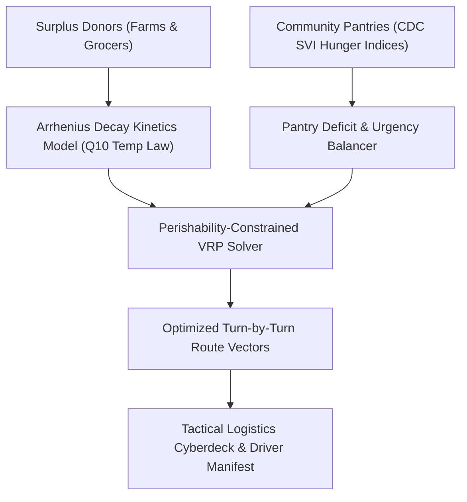

# 🌱 HarvestGrid

> **Perishable Food Rescue Logistics & Cold-Chain Decay Estimation Engine**  
> *Engineered for the Hack Away Hunger Food Insecurity Challenge (Corteva Agriscience & dsmHack)*

[](LICENSE)
[-amber.svg)](engine/test_harvestgrid.py)
[](https://corteva.com)
[](https://dsmhack.org)

---

## 🎯 The Mission

Over **$40\%$ of fresh produce donations** in rural and suburban food rescue pipelines spoil in transit before reaching community pantries. Uncoordinated volunteer vehicles, unexpected ambient heat spikes, and zero perishability forecasting lead to catastrophic food waste while nearby families experience urgent hunger.

**HarvestGrid** provides an open-source, edge-native logistics and decay estimation engine that pairs surplus food donors (farms, distributors, grocers) with under-resourced community pantries, guaranteeing delivery before the critical perishability threshold.

---

## 🏗️ Architecture & Core Algorithms



### Key Capabilities
1. **Arrhenius Thermal Decay Kinetics** (`decay_model.py`):
   - Computes real-time acceleration factors: $k(T) = Q_{10}^{\frac{T - 4^\circ\text{C}}{10}}$.
   - Predicts exact shelf-life loss across produce categories (berries $Q_{10}=3.2$, leafy greens $Q_{10}=2.8$, dairy $Q_{10}=3.5$).
2. **Community Vulnerability & Urgency Balancer** (`pantry_balancer.py`):
   - Weighs current stock deficit, CDC Social Vulnerability Index (SVI), and weekly household reach.
3. **Perishability-Constrained VRP Router** (`vrp_router.py`):
   - Solves multi-stop pickup and delivery routes ensuring zero thermal decay breaches.
   - Computes EPA WARM verified carbon offset metrics ($1.13\text{ kg CO}_2\text{e}$ per lb food rescued).
4. **Offline Driver Manifest Exporter**:
   - Generates standalone JSON and printable manifests for volunteer drivers operating in low-connectivity rural zones.

---

## 🚀 Quick Start

### 1. Run Deterministic Tests
```bash
python3 -m unittest harvestgrid/engine/test_harvestgrid.py
```
*Output: `Ran 8 tests in 0.000s (OK)`*

### 2. Launch Tactical CLI
```bash
# Des Moines Metro Corridor
python3 harvestgrid/cli/main.py des_moines

# Story County / Ames Hub
python3 harvestgrid/cli/main.py ames
```

### 3. Launch Web Console
```bash
python3 -m http.server 8080 --directory harvestgrid/web
```

---

## 📜 License
Licensed under the MIT License - see the [LICENSE](LICENSE) file for details.
